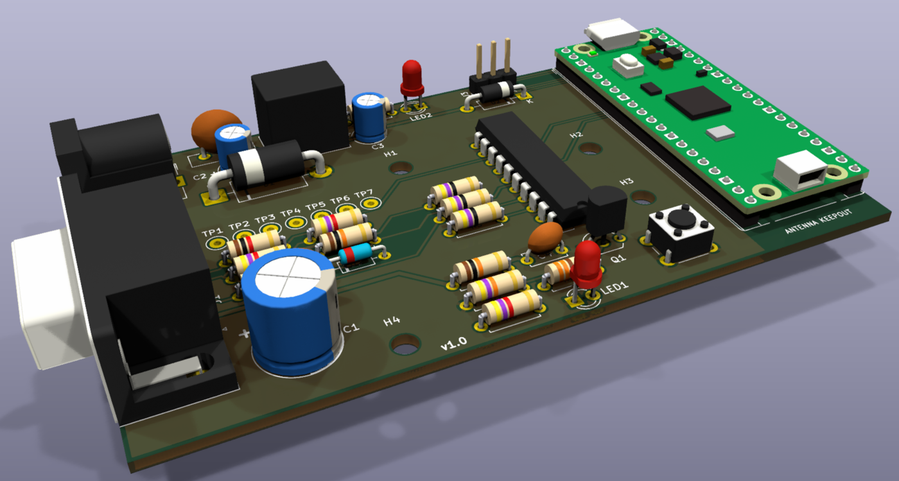
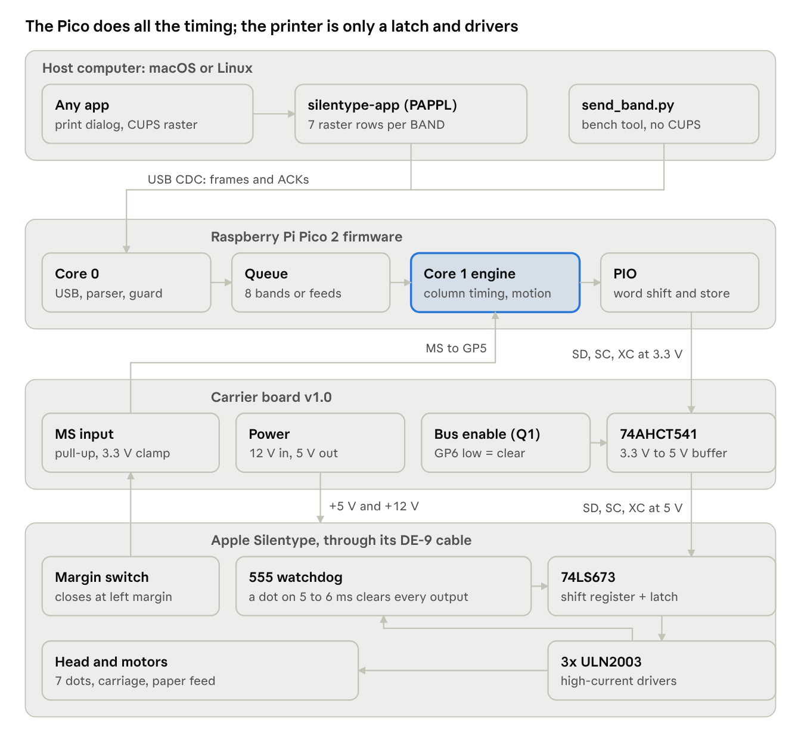
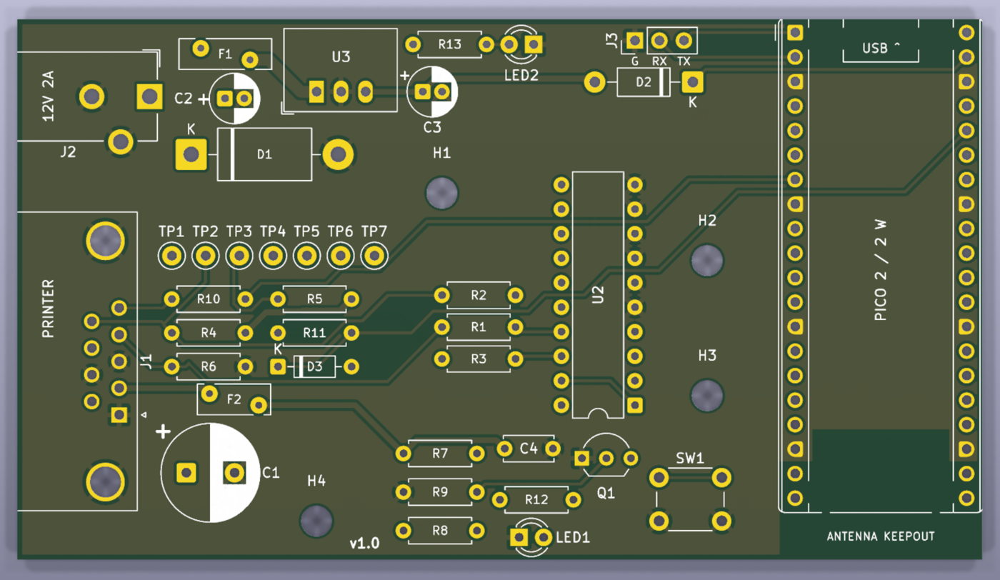
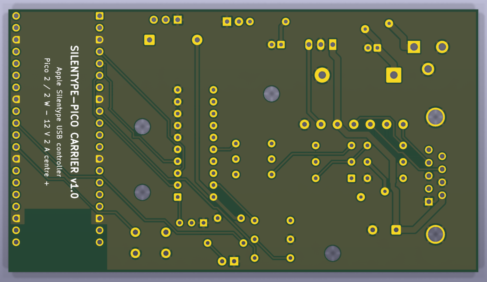
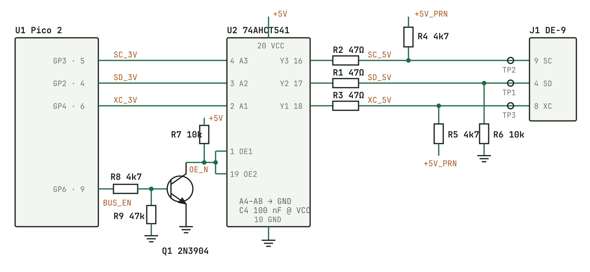
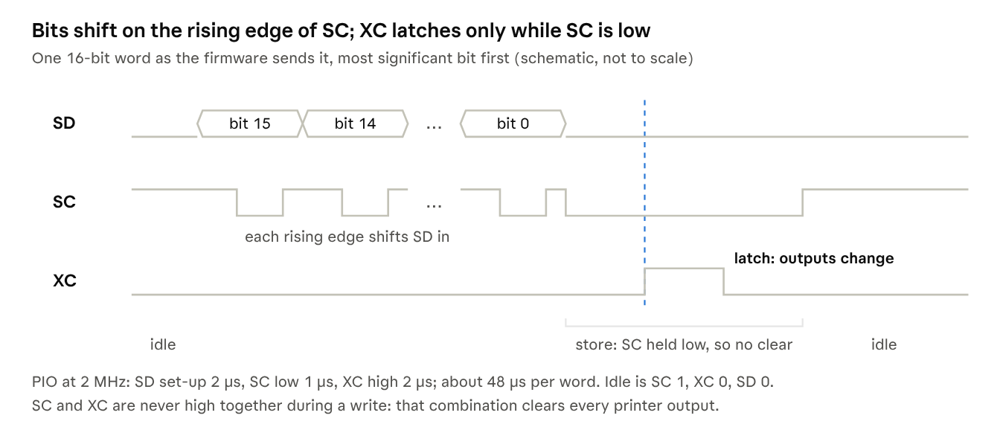
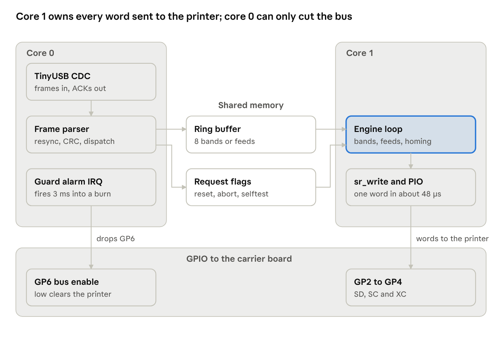
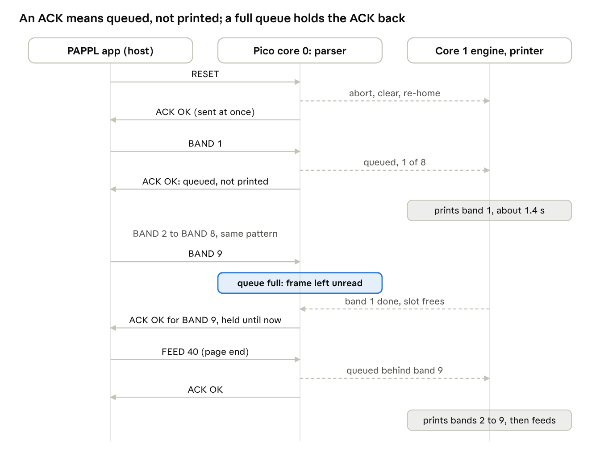

# silentype-pico

USB controller for the **Apple Silentype** thermal printer (1980, Trendcom 200 mechanism),
built on a Raspberry Pi Pico 2, with a host-side PAPPL printer application that presents it
to macOS and Linux as an IPP Everywhere printer (no driver install). The printer itself is not
modified: the carrier board plugs into its original DE-9 cable.



## Why this works

The Silentype has no processor. Apple used the Trendcom mechanism without Trendcom's
controller, so the host does all the timing; on the Apple II that host was the interface
card's 2 KB ROM running on the 6502. Inside the printer there is only a 74LS673 16-bit shift
register with an output latch, three ULN2003 driver arrays (7-dot head, carriage stepper,
paper stepper), a 555 head-on watchdog and a margin switch. Anything that produces the right
16-bit words at the right times can drive it. The Pico replaces the card and the 6502.

## Architecture



The host turns pages into 7-dot bands; the Pico turns bands into exactly timed 16-bit words; the
carrier converts levels and fails safe; the printer, unchanged, latches and drives. Details in the
[design overview](docs/design-overview.md).

## Documentation

| Document | What it covers |
|---|---|
| [Design overview](docs/design-overview.md) | Architecture, design principles, design-decision log, glossary |
| [Printer interface](docs/printer-interface.md) | Sources, printer electronics, DE-9 pinout, the 16-bit word, bus timing diagram, Apple's card decode, print timing tables, motion, corrections log |
| [Firmware design](docs/firmware-design.md) | Execution model, PIO transport, column schedule, motion, queue and errors, safety, configuration and SET_PARAM, tests, open issues |
| [Host software](docs/host-software.md) | USB transport, ACK flow control, PAPPL app, `send_band.py`, installation, open issues |
| [Band protocol](docs/protocol.md) | Wire format: frames, commands, payloads, example bytes |
| [Carrier board](hardware/pcb/README.md) | Build pipeline, circuit, schematic sheets, renders, layout rules |
| [Bill of materials](hardware/BOM.md) | Component choices; [`BOM.csv`](hardware/BOM.csv) generated from the board |
| [Bring-up and tests](docs/bring-up.md) | What is verified, bench procedure with pass criteria, milestone plan, measurement log |
| [Known issues](docs/KNOWN-ISSUES.md) | Audit trail and every open issue |
| [Hardware interface evidence](docs/firmware-archaeology/HARDWARE-INTERFACE.md) | Signal-by-signal evidence from Apple's schematics and ROM |
| [Firmware README](firmware/README.md) | Build, file map, pins |

## Gallery

| Bare PCB, front | Bare PCB, back (mirrored) |
|---|---|
|  |  |

| Printer bus schematic | Bus timing |
|---|---|
|  |  |

| Firmware execution model | Host ACK flow |
|---|---|
|  |  |

More: [power and input schematics](hardware/pcb/README.md#schematic), [assembled top view](docs/images/render-top.png).

## Repository map

| Path | Contents |
|---|---|
| `firmware/` | Pico SDK project: CMake, TinyUSB CDC, PIO transport, print engine |
| `firmware/test/` | Host-side test harness: runs the real engine and parser on a PC (`make -C firmware/test`) |
| `hardware/pcb/` | Carrier v1.0 generated from code: `build_carrier.py`, `Makefile`, KiCad board, Gerbers, renders |
| `hardware/BOM.csv`, `hardware/BOM.md` | Bill of materials and component notes for carrier v1.0 |
| `host/pappl-app/` | PAPPL printer application |
| `host/tools/send_band.py` | Bench tool (no CUPS needed) |
| `host/linux/`, `host/macos/` | udev rule, systemd unit, launchd agent |
| `docs/protocol.md` | Band protocol (host ⇄ Pico) |
| `docs/signals.md` | DE-9 signal map and bus waveform |
| `docs/*.md` | Design documents (see Documentation above); `docs/images/` holds renders and diagrams |
| `docs/bring-up.md` | Bench bring-up procedure, milestone test plan, measurement log |
| `docs/KNOWN-ISSUES.md` | Audit trail and open issues |
| `docs/firmware-archaeology/` | Apple /// driver, Apple II card ROM, schematics, `HARDWARE-INTERFACE.md` (the definitive interface) |
| `docs/reference/` | Silentype manual, TA27850 pinout, Trendcom manual |

## Quick start

```
# firmware (needs the Pico SDK and an ARM toolchain)
export PICO_SDK_PATH=~/pico-sdk
cmake -B build -S firmware && cmake --build build      # → build/silentype.uf2

# firmware tests on the PC (gcc only)
make -C firmware/test

# carrier PCB: regenerate, route, DRC, Gerbers, renders (KiCad 10, Java 25, Freerouting 2.5)
make -C hardware/pcb FREEROUTING_JAR=/path/to/freerouting-2.5.0.jar

# talk to the printer without CUPS
python3 host/tools/send_band.py status
```

The PCB fab package is `hardware/pcb/fab/silentype-carrier-gerbers.zip` (2 layers, 1.6 mm,
100 × 56 mm; standard JLCPCB/PCBWay rules).

## Status

| Area | State |
|---|---|
| Reverse engineering | Done: Apple /// driver, Apple II card ROM, printer and card schematics, DE-9 pinout |
| Firmware | Written; host-simulated tests pass; **not yet built with the real Pico SDK** |
| Carrier PCB v1.0 | Routed, DRC clean (0 errors, 0 unconnected), Gerbers exported; not yet ordered |
| PAPPL app | Written against PAPPL 1.4 from memory; not compiled; known blocking bugs (`docs/KNOWN-ISSUES.md`) |
| Bench | Not started |

## Milestones

- [x] **M0a** Apple /// SOS driver found and disassembled
- [x] **M0b** Card ROM, both schematics and DE-9 pinout found; serial PIO transport written
- [ ] **M1** Bench characterisation: head element count and resistance, supply current
- [ ] **M2** Carrier built; margin switch readable; bus enable and store verified on the scope
- [ ] **M3** Carriage homes and sweeps under Pico control
- [ ] **M4** A single column burns cleanly at conservative timing
- [ ] **M5** Test-pattern band prints in both directions
- [ ] **M6** Band protocol end to end via `host/tools/send_band.py`
- [ ] **M7** PAPPL app prints PWG raster; visible in the macOS/Linux print dialog
- [ ] **M8** `lp -d silentype file.pdf` produces paper
- [ ] **M9** Reverse-pass registration tuned

Pass criteria for each are in `docs/bring-up.md`.

## Safety model (read before powering anything)

The print head is the one irreplaceable part. Three independent layers turn it off:

1. **Printer's 555 watchdog (inside the printer).** It watches the head driver outputs; if any
   element stays on for about 5–6 ms it clears the 74LS673's outputs, motors included.
2. **Carrier bus enable (hardware).** The 74AHCT541 drives the bus only while GP6 is high. When
   the Pico is in reset, unpowered, or the guard drops GP6, the buffer releases the bus and the
   carrier's pull-ups hold SC = XC = 1, which asynchronously clears every printer output.
3. **Software guard (firmware).** Every burn is capped at 3000 µs, and an alarm on core 0 drops
   GP6 if a burn overruns. This catches logic bugs; it is not a substitute for 1 and 2.

Plus: fused 12 V (2 A PTC, reverse-polarity crowbar), fused printer 5 V (0.5 A PTC), and a
current-limited bench supply for first power-up. The firmware defaults to intensity level 1,
well below Apple's default 5, until the head has been characterised.

## Ground truth

All timing and bit positions come from Apple's own code and schematics, archived in
`docs/firmware-archaeology/`: the Apple /// `.SILENTYPE` driver (7-element head, burn timing,
wave-drive stepping, bidirectional printing with 2-column thermal lookback), the Apple II card
ROM 341-0039-00 with Marc Ressl's disassembly (exact bit order, store sequence, 8-level burn
table), the printer schematic 050-0023-01, the card schematics 050-0024-00/-01 and Apple KB
TA27850. `HARDWARE-INTERFACE.md` is the definitive summary.

Still unknown until the bench: exact column count on paper, reverse-pass trim, head element
resistance, and which of Apple's two burn tables the head prefers.
