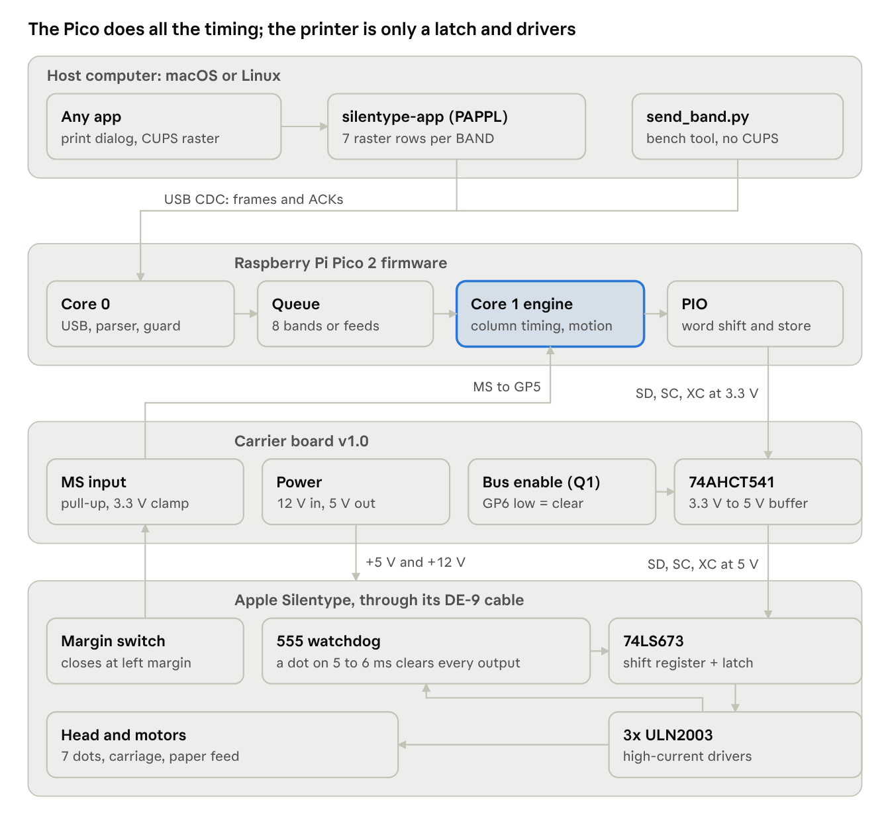

# Design overview

[README](../README.md) · **Design overview** · [Printer interface](printer-interface.md) · [Firmware design](firmware-design.md) · [Host software](host-software.md) · [Carrier board](../hardware/pcb/README.md) · [Bring-up and tests](bring-up.md)

Each layer does one job. The host turns pages into 7-dot bands; the Pico turns bands into
exactly timed 16-bit words; the carrier converts levels and fails safe; the printer, unchanged,
latches and drives.

Print data flows down from the host. The only signal flowing back up is the margin switch, read
on GP5 for homing. Core 0 handles USB and owns the software guard, which can drop the bus-enable
line; core 1 owns every word sent to the printer.

## Design principles

1. **Ground truth before code.** Every timing constant and bit position comes from Apple's ROMs,
   Apple's schematics or a bench measurement. Values not yet known are marked `TBD_FROM_ROM` in
   `firmware/src/config.h` and must be resolved before the head rail is connected.
2. **The head is protected by hardware first.** Three independent layers turn it off: the
   printer's own 555 watchdog (about 5–6 ms); the carrier's bus-enable switch, which clears the
   printer whenever the Pico is in reset, unpowered or tripped; and a software guard timer.
3. **Copy Apple's behaviour, then improve it.** Apple's word format, store sequence, stepping
   pattern and 2-column thermal lookback are kept. Improvements (a constant column period, a
   hardware fail-safe) are added on top, never in place of what Apple proved.
4. **Code is the single source of truth.** The PCB is generated by
   `hardware/pcb/build_carrier.py`, and `make` rebuilds board, DRC, Gerbers and renders from it.
   Shared geometry lives in `config.h` and `protocol.h`.
5. **Verify by simulation before the bench.** The print engine and parser run on a PC with a
   virtual clock; the PIO program was checked in a cycle-level model of the printer and of
   Apple's card; every board build must pass DRC with zero errors.

## Design decisions

| Area | Chosen | Rejected | Why |
|---|---|---|---|
| USB link | CDC serial port | USB printer class (class 7) | macOS's printer driver and Linux's raw queue both claim a class-7 device and fight the printer app |
| Driving the printer bus | One PIO state machine for the whole word, store included | CPU bit-banging; SPI plus a GPIO store | The store must happen with SC low and SC/XC must never both be high; in PIO the edge order cannot be disturbed |
| Level shifting | 74AHCT541 octal buffer | 74AHCT125; direct 3.3 V drive | Flow-through pinout routes cleanly; the printer's 3 kΩ pull-ups would push current into 3.3 V pins |
| Hardware fail-safe | Bus enable (Q1) plus pull-ups, using the printer's own latch clear | A 74HC123 one-shot on the carrier | Releasing the bus clears head and motors whenever the Pico is in reset, unpowered or tripped; a one-shot would also have blocked Apple's longer legitimate burns |
| Software guard | Drop the bus-enable pin from the alarm interrupt | Write an all-off word from the interrupt | A write from core 0 could collide with core 1's PIO traffic |
| Reverse-polarity protection | Crowbar diode after the PTC fuse | Series diode; P-MOSFET | No voltage drop on the head supply; a reversed plug trips the fuse |
| 5 V supply | RECOM R-78E switching module | 7805; USB VBUS | A 7805 would dissipate about 1 W; VBUS dies with the cable and is limited to 500 mA |
| Pico power | VSYS through a Schottky diode | Separate supplies | USB and the board supply can be connected together safely |
| Parts | All through-hole | Surface mount | Hand assembly with an ordinary iron |
| Pico position | Right edge, USB at the top, antenna end at the bottom edge with a copper keepout | Centre of the board | USB reachable; a Pico 2 W gets clear radio |
| PCB authoring | Generated by `build_carrier.py`, routed by Freerouting, gated by DRC | Hand layout in the KiCad GUI | Reproducible and reviewable as code |
| Column timing | Fixed slots scheduled against each column's start | Summed delays | Blank and printed columns take the same time, so the open-loop stepper keeps its pace |
| Paper feeds | Queued with the bands | A separate request flag | A page-end feed runs after the page's last band |
| Default intensity | Level 1 (823 µs) | Apple's level 5 (1921 µs) | The head is irreplaceable and not yet characterised; tune upward on paper |

## Glossary

| Term | Meaning |
|---|---|
| Band | One horizontal strip of print, 7 dots tall, sent as one BAND frame with one byte per column |
| Column | One vertical slice of a band: the 7 dots the head prints at one carriage position |
| SD, SC, XC | Serial data, shift clock and store clock: the bus lines to the printer's shift register |
| MS | Machine status: the margin switch line, low at the left margin |
| Store | Copying the shift register into the 16 latched outputs on XC's rising edge |
| Clear | SC and XC high together: asynchronously turns every latched output off |
| Bus enable | The carrier's GP6-controlled switch that lets the buffer drive the bus; off holds the printer cleared |
| Pre-heat | A short burn on dots that were off in the previous two columns |
| Intensity level | 0–7; selects burn, pre-heat and off times from the card ROM's table |
| PIO | The RP2350's programmable I/O state machines |
| PAPPL | A C library for IPP Everywhere printer applications |
| CDC | USB Communications Device Class: the device appears as a serial port |
| ULN2003 | Seven-channel Darlington driver sinking head and motor current |
| 74LS673 | The printer's 16-bit shift register with output latch |
| Wave drive | Stepping with one motor phase energised at a time |
| DRC | KiCad's design rule check |
