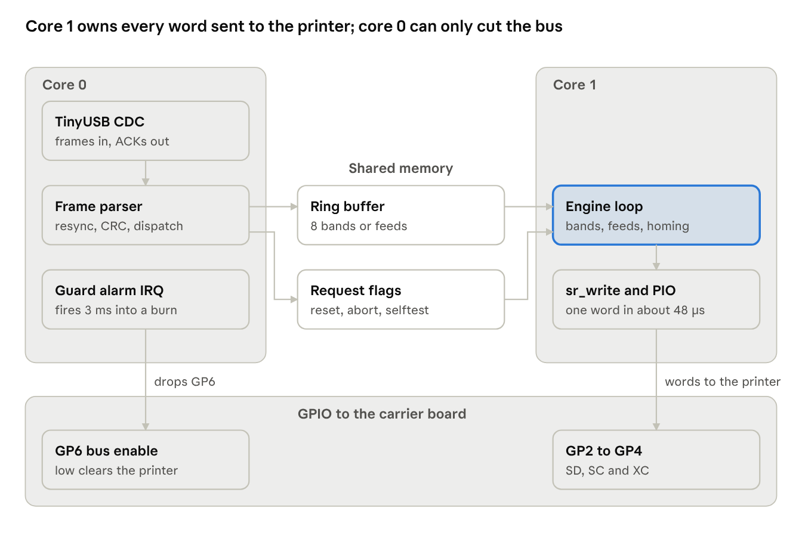

# Firmware design

[README](../README.md) · [Design overview](design-overview.md) · [Printer interface](printer-interface.md) · **Firmware design** · [Host software](host-software.md) · [Carrier board](../hardware/pcb/README.md) · [Bring-up and tests](bring-up.md)

The Pico 2 firmware turns queued 7-dot bands into exactly timed 16-bit words for the printer's
latch. Build instructions and the file map are in [`firmware/README.md`](../firmware/README.md).

## Execution model

The work splits by deadline. Core 0 handles what can wait (USB, parsing, replies); core 1 runs
the time-critical engine and is the only code that writes words to the printer. They share an
8-entry ring buffer and a few volatile request flags. The guard alarm is the one path from core 0
to the hardware: it drops GP6, a single register write that cannot collide with core 1's PIO
traffic.

## PIO transport

One `sr_write()` is one atomic PIO transaction at 2 MHz (0.5 µs per cycle):

1. `pull block` with SC high, XC low (idle).
2. 16 times: `out pins, 1` sets SD while SC is high (1 µs); SC low (1 µs); SC rises and shifts.
3. `mov pins, null`: SD low, SC low (2 µs).
4. XC high (2 µs): the latch edge.
5. XC low (2 µs), SC still low.
6. `irq set 0` with SC back high: idle, and the CPU is told the store happened.

SC (GP3) and XC (GP4) are one 2-pin side-set, so `PIN_XC` must be `PIN_SC + 1` (static assert).
The OSR shifts left and the CPU pushes `word << 16`, so bit 15 goes first. The side-set value
with SC and XC both high (the clear) is never emitted.

| Function | Behaviour |
|---|---|
| `sr_init()` | Bus released; load the program; SC = XC = 1 for 10 µs (clear); idle; enable the bus; latch all-off |
| `sr_write(word)` | Forces bit 8 to 0; blocks ~48 µs; the latch edge is ~43 µs after the call |
| `sr_make(head7, carr4, feed4)` | Head → bits 9–15, paper → 4–7, carriage → 0–3 |
| `sr_bus_enable(on)` | One SIO write to GP6; safe from any core or IRQ |

## Print engine

Every column takes exactly the same time at a given intensity, whatever dots it holds, because the
carriage stepper is open loop. Each column is scheduled against its start time t0:

| Slot | Starts at | Head |
|---|---|---|
| Pre-heat | t0 | Cold dots (off in both previous columns) on, or off |
| Burn | t0 + PRE | All dots on for the burn time, then off |
| Off | t0 + PRE + BURN | Off until t0 + P |

P = PRE + BURN + max(OFF + TAIL, 100 µs). A late start never shortens a burn: each pulse is held
for its full length from its on-write, and the next slot absorbs the delay.

| Level | Pre-heat (µs) | Burn (µs) | Off (µs) | Period (µs) |
|---|---|---|---|---|
| 0 | 735 | 549 | 1225 | 2509 |
| 1 (default) | 588 | 823 | 1078 | 2489 |
| 2 | 470 | 1098 | 960 | 2528 |
| 3 | 294 | 1372 | 784 | 2450 |
| 4 | 196 | 1646 | 686 | 2528 |
| 5 | 98 | 1921 | 588 | 2607 |
| 6 | 24 | 2195 | 514 | 2733 |
| 7 | 5 | 2744 | 495 | 3244 |

Passes alternate direction: forward passes step after each column; reverse passes move to the
band's right edge plus `reverse_offset` and step before each column. Band flag bit 0 forces forward.
An optional heat accumulator (`HEAT_DECAY`, `HEAT_K`) is off by default.

## Motion

- Wave drive {0x1, 0x8, 0x4, 0x2} for both motors; the head is off on every step word.
- Carriage: one step per column while printing; 4032 µs/step when moving. Ramp coded, disabled.
- Homing at power-up and RESET: step left until MS reads low, 3 s time-out (~735 steps).
- Paper feed: 4032 µs/step, then the feed phases are released. Default 7 steps per band.

## Queue, errors and recovery

Bands and feeds share the 8-entry ring (a feed has width 0), so feeds stay in order. When full,
the parser leaves the frame unread and withholds the ACK; the host's write blocks.

| Error | Code | Raised when |
|---|---|---|
| `ERR_CRC` | 1 | A frame fails its CRC |
| `ERR_HEAD_FAULT` | 2 | The software guard fired during a burn |
| `ERR_HOME_TIMEOUT` | 3 | The margin switch did not close within 3 s |
| `ERR_PAPER_OUT` | 4 | Never (no paper sensor) |
| `ERR_INVALID_BAND` | 5 | Reserved |

In the error state the engine discards queued work and refuses new bands and feeds. RESET aborts
within one column, clears the queue and error, re-enables the bus, latches all-off and re-homes.

## Head safety in firmware

1. Per-pulse cap `BURN_HARD_LIMIT_US` = 3000 µs; SET_PARAM refuses higher burns.
2. Head bits are 0 on every motor word.
3. Every head-on pulse arms a 3000 µs alarm on core 0; if it fires, GP6 drops, the carrier clears
   the printer in hardware, and the burn fails with `ERR_HEAD_FAULT` until RESET.
4. `sr_init` keeps the bus released until the PIO is running and the printer is cleared.

## Configuration

| GPIO | Constant | Use |
|---|---|---|
| GP2 | `PIN_SD` | Serial data |
| GP3 | `PIN_SC` | Shift clock |
| GP4 | `PIN_XC` | Store clock (= GP3 + 1) |
| GP5 | `PIN_MS` | Margin switch, active low |
| GP6 | `PIN_BUS_EN` | Carrier bus enable |
| GP22 / GP26 | `PIN_BTN_FEED` / `PIN_LED_ERR` | Defined, not yet used |

| SET_PARAM id | Parameter | Range |
|---|---|---|
| 0x01–0x08 | Burn time for level 0–7 (id = 0x01 + level) | 1–3000 µs |
| 0x10 | Carriage step interval when moving | 300–20000 µs |
| 0x11 | Off time, all levels | 0–20000 µs |
| 0x12 | Reverse-pass offset | −50–50 steps |
| 0x13 | Default feed steps per band | 1–255 |
| 0x20 / 0x21 | Heat decay / heat K | 0–255 |

## Testing

`make -C firmware/test` runs the real `print_engine.c` and `main.c` against SDK stubs with a
virtual clock and a recorder of every latched word. `test_timing` checks identical column periods
at levels 0, 1, 3 and 7 in both directions, head off on step words and no pulse over the cap;
`test_queue` checks FEED ordering, back-pressure, invalid and error replies, and RESET. Both fail
on the pre-review firmware. The simulator charges 23 µs per write (real: ~48 µs).

## Open issues

| Severity | Issue |
|---|---|
| Medium | RESET during a paper feed leaves a feed coil energised |
| Medium | Paper feed steps every 4 ms; Apple used ~8–11 ms |
| Medium | Carriage steps every ~2.5 ms while printing at level 1, faster than Apple's ~4.3 ms |
| Medium | The ROM settle delay is used as a pre-heat; tables not yet reinterpreted |
| Low | Burns within ~50 µs of the 3000 µs cap trip the guard every column |
| Low | A half-received frame survives a USB reconnect |
| Low | Homing reach ~735 vs Apple's 792 steps; negative reverse offset can pass home |
| Low | `engine_state` written by both cores |
| Low | Feed button and error LED unused; dead parallel-GPIO and ADC code |
