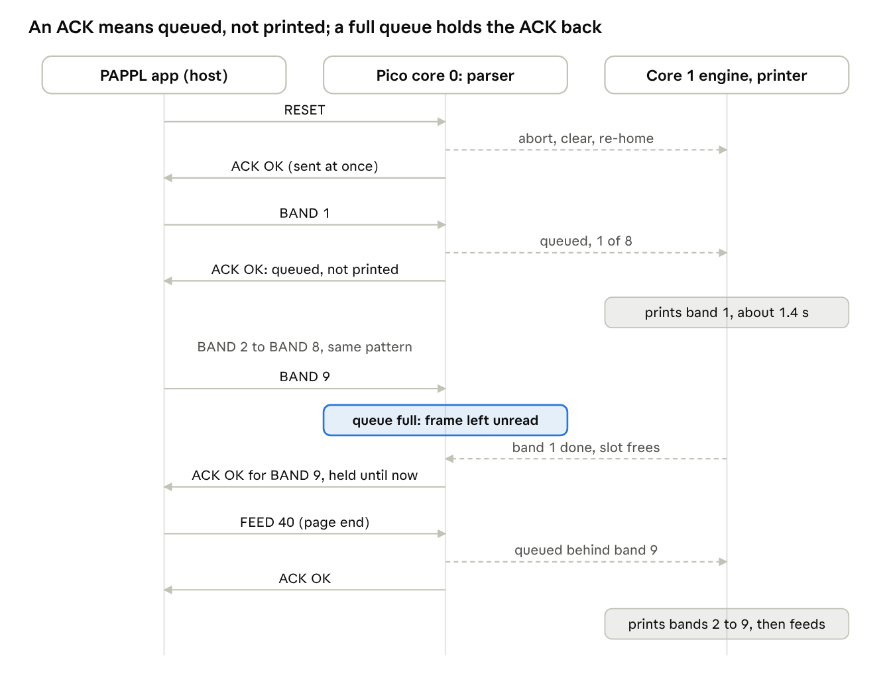

# Host software

[README](../README.md) · [Design overview](design-overview.md) · [Printer interface](printer-interface.md) · [Firmware design](firmware-design.md) · **Host software** · [Carrier board](../hardware/pcb/README.md) · [Bring-up and tests](bring-up.md)

The host sends 7-dot-tall bands to the Pico over USB serial, framed and CRC-checked, and the Pico
acknowledges each one. The wire format is specified in [`protocol.md`](protocol.md); this document
covers the transport choice, flow control and the two host programs.

## Transport

| OS | Device | Notes |
|---|---|---|
| Linux | `/dev/ttyACM*`, plus `/dev/silentype` with the udev rule | Serial group (`dialout`; `uucp` on Arch) |
| macOS | `/dev/cu.usbmodem*` | Use `cu.`, not `tty.` |

USB CDC-ACM needs no driver anywhere. USB printer class (class 7) was rejected: macOS claims it
with its own printer driver and Linux creates a phantom raw queue, both fighting the printer app.
The firmware services the port only while DTR is asserted (pyserial and `open()` both do).

## ACKs and flow control



The host sends one command and waits for its reply. An ACK means **queued, not printed**, so the
host can run up to 8 entries ahead of the paper; once the queue is full the Pico stops reading
USB and the next ACK waits until a slot frees. Any host must allow an ACK wait longer than one
band's print time (the PAPPL app allows 10 s, `send_band.py` 15 s), and must not send RESET right
after a job's last ACK, because up to 8 bands and the page feed may still be printing.

## PAPPL printer app (`host/pappl-app/`)

A local IPP Everywhere server, so macOS and Linux add the Silentype from the ordinary print dialog.
Written against the PAPPL 1.4 API from memory; **not yet compiled**, with blocking bugs (below).

```
make -C host/pappl-app
./silentype-app server -o listen-hostname=localhost
./silentype-app add -d silentype -v serial:///dev/ttyACM0 -m silentype
```

- **Device scheme.** Its own `serial://` scheme talks to the port directly (no libusb). Listing
  probes `/dev/ttyACM*` and `/dev/cu.usbmodem*` with STATUS and reports only real Silentype-Picos.
- **Driver.** 1-bit black raster (CUPS dithers); 60 × 60 dpi and 480 columns (both wrong, see
  issues); continuous roll media; print-darkness → intensity.
- **Job flow.** RESET + ACK at job start. Every 7 raster lines become one BAND (line r → bit 6 − r),
  sent and ACK-checked. At page end the partial band is padded white, then FEED 40 (~1 inch).
  Every ACK is checked for the right command echo and an OK result.
- **Status.** STATUS maps the engine's error state to IPP printer-state-reasons.

## Bench tool (`host/tools/send_band.py`)

| Command | Example | Does |
|---|---|---|
| `status` | `send_band.py status` | State, error, queue use, bands printed, uptime |
| `reset` | `send_band.py reset` | Clear error and queue, re-home |
| `selftest` | `send_band.py selftest` | Built-in checker band, forward then reverse |
| `pattern` | `send_band.py pattern --intensity 0` | 200-column checker band |
| `image` | `send_band.py image chart.png --intensity 1` | Scale, pad to whole bands, threshold, send |
| `feed` | `send_band.py feed 40` | Paper feed in steps (40 ≈ 1 inch) |
| `burn` | `send_band.py burn 1 300` | Level 1 burn = 300 µs (SET_PARAM 0x02) |
| `setparam` | `send_band.py setparam 0x10 1500` | Raw SET_PARAM |

Needs pyserial (and Pillow for `image`); `--help` works without them. Replies are CRC-checked;
a missing ACK, wrong echo or NAK is reported and the tool exits 1.

## Installing

**Linux** (`host/linux/`): copy `99-silentype.rules` to `/etc/udev/rules.d/` (adjust the group on
Arch); install the app to `/usr/local/bin/`; create a `silentype` user in the serial group and
`/var/spool/silentype`; install `silentype-app.service` and `systemctl enable --now silentype-app`.

**macOS** (`host/macos/`): build PAPPL from source against Homebrew libcups; copy
`com.janus.silentype-app.plist` to `~/Library/LaunchAgents/` and `launchctl load` it.

## Open issues

| Severity | Issue | Fix |
|---|---|---|
| Critical | `papplDeviceWrite` is buffered and never flushed: no frame is ever sent | Flush after each frame |
| Critical | Device-list callback returns `void` (GCC 14+ error); stop/continue logic inverted | Return `bool`; stop when the callback returns true |
| High | RESET at job start aborts the previous job's queued bands and page feed | Poll STATUS until idle first, or RESET only after an error |
| Medium | Media width in wrong units (576 mm vs 203.2 mm) | 20320 hundredths of a mm |
| Medium | 60 dpi vertical; one dot row is one paper step (~40/in) | 40 dpi vertical |
| Medium | 480 columns vs the firmware's 560 | One shared header |
| Low | Darkness → intensity 1–5, default 3 | 0–7, default 1 |
| Low | Probes every `/dev/ttyACM*` | Match VID/PID or use `/dev/silentype` |
| Low | Driver `format` without a print-file callback | Check on first compile |
