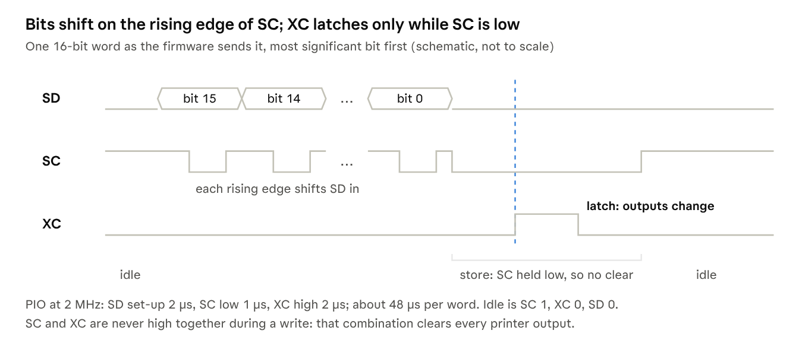

# Printer interface

[README](../README.md) · [Design overview](design-overview.md) · **Printer interface** · [Firmware design](firmware-design.md) · [Host software](host-software.md) · [Carrier board](../hardware/pcb/README.md) · [Bring-up and tests](bring-up.md)

How the Silentype's electrical interface and print timing were recovered from Apple's own code
and schematics. This is the readable summary; the evidence, signal by signal, is in
[`firmware-archaeology/HARDWARE-INTERFACE.md`](firmware-archaeology/HARDWARE-INTERFACE.md).

## Sources

| Source | Archived at | What it settled |
|---|---|---|
| Apple /// SOS `.SILENTYPE` driver v1.1 (Diskware 681-0009-A) | `firmware-archaeology/BIG.DRIVER`, `.dis` | 7-element head; burn, pre-heat and off times; wave-drive stepping; bidirectional printing; 2-column thermal lookback |
| Apple II card ROM 341-0039-00 (2 KB) | `firmware-archaeology/apple2-card/341-0039-00.bin` | Exact transmit order of the word; the store sequence; the 8-level intensity table |
| Marc S. Ressl's disassembly (2010) | `firmware-archaeology/apple2-card/silentype.s` | Routine names. Its `$27`/`$35` labels are swapped and its I/O bit labels are wrong |
| Printer schematic 050-0023-01 | `firmware-archaeology/printer/` | 74LS673, three ULN2003s, 555 watchdog, clear logic, margin switch, dot order |
| Card schematics 050-0024-00/-01 | `firmware-archaeology/apple2-card/` | How the card's I/O register becomes the DE-9 waveform |
| Apple KB TA27850 | `reference/silentype-pinouts-TA27850.txt` | DE-9 pinout |
| Silentype Operation and Reference Manual | `reference/` | 80 columns; ~40 paper steps per inch; intensity levels; line spacing |

## Printer electronics

The printer contains no processor: one shift register, three driver arrays, a timer and a switch.

| Part | Function |
|---|---|
| 74LS673 | 16-bit serial-in shift register with a 16-bit output latch and asynchronous clear |
| 74LS00 | Inverts SC for the 673's shift clock; forms the clear condition from SC and XC |
| ULN2003 ×3 | Head (Y09–Y15, 7 elements, common +12 V); carriage motor (Y00–Y03); paper motor (Y04–Y07) |
| MC14082 + 555 | Head-on watchdog: if any element stays on ~5–6 ms it clears the latch, motors included |
| Margin switch | SPST to ground at the left margin; the only sensor (no paper-out sensor, no encoder) |

## DE-9 connector

| Pin | Signal | Direction (host view) |
|---|---|---|
| 1 | Shield ground | — |
| 2 | +5 V | to printer |
| 3 | Logic ground | — |
| 4 | SD, serial data | to printer |
| 5 | MS, machine status (margin switch) | from printer |
| 6 | +12 V (head and motors) | to printer |
| 7 | Power ground | — |
| 8 | XC, store clock | to printer |
| 9 | SC, shift clock | to printer |

SD, SC and XC are 5 V TTL inputs; SC and XC have 3 kΩ pull-ups to +5 V inside the printer.

## The 16-bit word

Bit 15 is shifted first and lands on Y15.

| Word bits | Outputs | Drives |
|---|---|---|
| 15 | Y15 | Head element 7, **top** dot |
| 14–10 | Y14–Y10 | Head elements 6–2 |
| 9 | Y09 | Head element 1, **bottom** dot |
| 8 | Y08 | The 673's own R/W̅ pin — must be 0 |
| 7–4 | Y07–Y04 | Paper-feed motor phases |
| 3–0 | Y03–Y00 | Carriage motor phases |

In print data a column byte uses bit 6 for the top dot and bit 0 for the bottom (head bit i →
word bit 9 + i). The Apple /// font confirms it: 'T' starts with 0x40, 'Y' with 0x70, 'U' with 0x7E.

## Bus waveform

The firmware reproduces Apple's edge order: data set while SC is high, a short SC low pulse whose
rising edge shifts, and a store with SC held low. SC and XC high together asynchronously clears
all 16 outputs; the carrier uses that on purpose as its fail-safe.

## How Apple's card generates it

The card's 74LS174 output register holds the last byte written to its I/O address:

| Bit | Effect |
|---|---|
| D0 | SD level |
| D1 | Writing 1 fires one ~1 µs SC low pulse |
| D2 | XC = NOT D2 |
| D3 | SD driver enable (off: 1.1 kΩ pulls SD low) |
| D4 | Forces SC low |
| D6 | 1 disconnects the SC driver |

`sendState` sends head bits 6→0, then a 0, then the motor byte 7→0, one `$0E | bit` write per
bit. The store is `$1C` (SC low), `$18` (XC rises: latch), `$1C` (XC falls), `$0C` (SC high, idle).
`resetPrinter` writes `$00`: SC and XC both high, the clear.

## Print timing

Both Apple drivers print a column as: step, pre-heat the cold elements, burn all elements, head off.

**Apple II card ROM** (`printDotColumn`, 6502 at 1.0205 MHz, ~440 µs per word shifted):

| Level | Step-2 wait, head off (µs) | Main wait (µs) | Off wait (µs) |
|---|---|---|---|
| 0 | 735 | 549 | 1225 |
| 1 | 588 | 823 | 1078 |
| 2 | 470 | 1098 | 960 |
| 3 | 294 | 1372 | 784 |
| 4 | 196 | 1646 | 686 |
| 5 (default) | 98 | 1921 | 588 |
| 6 | 24 | 2195 | 514 |
| 7 | 5 | 2744 | 495 |

The first column was originally read as a pre-heat; it is a head-off settle after the step. The
real pre-heat is the ~440 µs it takes to shift the next word, and each real burn is the main wait
plus ~440 µs.

**Apple /// driver:** cold-dot word 512 µs, all-dots 640 µs (896 µs "dark"), off 2624 µs plus a
travel adder that drops 4 µs per column on reverse passes, then a 512 µs tail; ~4.3 ms per column.

The firmware uses the card table, starting at level 1, until the head is characterised.

## Motion and geometry

| Item | Value | Source |
|---|---|---|
| Phase sequence | one-hot {1, 8, 4, 2} | /// `$0A58`, card ROM |
| Step interval when moving | 4032 µs | /// `$0AC0` |
| Paper feed step | ~8 ms (///), ~11 ms (card) | /// `$0AAE`, card `doFormFeed` |
| Homing | step left to the margin switch; /// gives up after 792 steps | /// `$0ADA` |
| Characters / columns per line | 80 / ~560 (not yet measured) | card ROM, manual |
| Paper steps per inch | ~40 | manual p. 21 |
| Text line pitch | 7 dot rows + 2 steps | manual p. 22 |

## Corrections log

| When | Was believed | Turned out |
|---|---|---|
| Review, Nov 2026 | The 555 is triggered by SC·XC, so XC must pulse with SC high | SC·XC is the clear; the 555 watches the head drivers; the store happens with SC low |
| Review, Nov 2026 | The word is sent bit 0 first | Bit 15 first, landing on Y15 |
| Review, Nov 2026 | Bit 0 of print data is the top dot | Bit 6 is the top dot |
| Review, Nov 2026 | The ROM's first delay is a pre-heat | It is a head-off settle; pre-heat is the shift time |
| M0b | A 26-pin ribbon with parallel head and motor lines | A DE-9 with three serial lines and one sense line |
| M0b | A paper-out sensor exists | None exists |
| M0a | Head element count unknown | 7 |

Still to confirm on the bench: see [bring-up and tests](bring-up.md).
