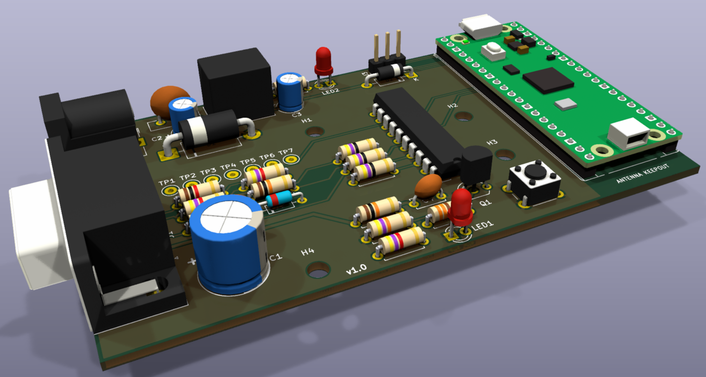
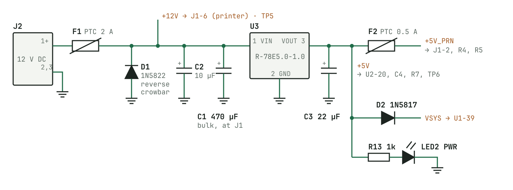
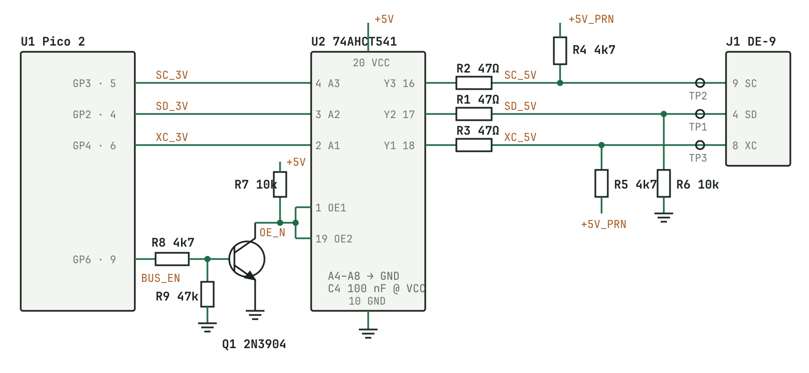
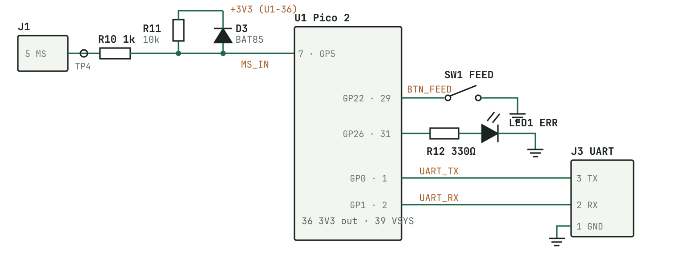
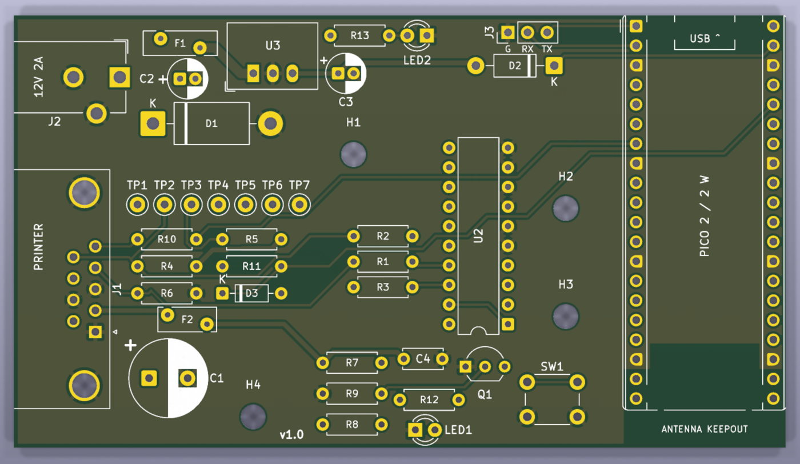
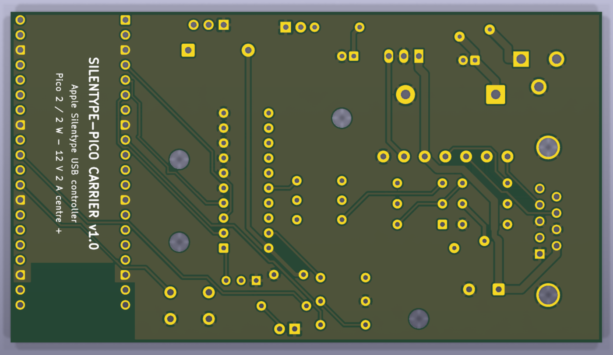
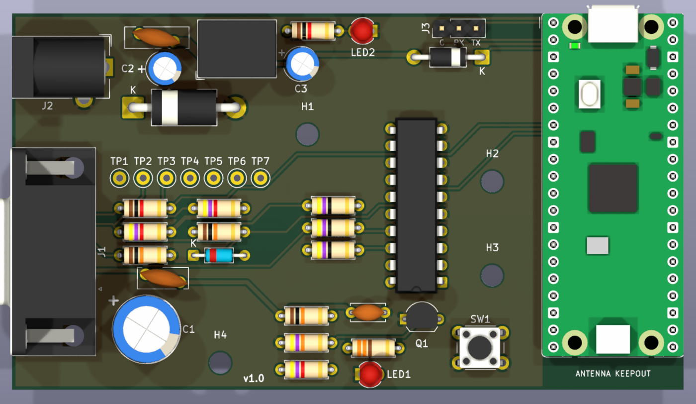

# Carrier board v1.0

[README](../../README.md) · [Design overview](../../docs/design-overview.md) · [Printer interface](../../docs/printer-interface.md) · [Firmware design](../../docs/firmware-design.md) · [Host software](../../docs/host-software.md) · **Carrier board** · [Bring-up and tests](../../docs/bring-up.md)



100 × 56 mm, 2-layer, all through-hole. Routed, **DRC clean (0 errors, 0 unconnected)**,
Gerbers exported; not yet ordered. The whole board is generated from `build_carrier.py`.

| File | What it is |
|---|---|
| `build_carrier.py` | Parts, nets, placement, design rules, keepouts, silkscreen; `place`, `finish`, `bare` steps |
| `gen_resistor_models.py` | Writes `models/R_<value>.wrl`: 3D resistor models with the correct 4-band colour code |
| `check_drc.py` | Fails the build on any DRC error or unconnected net |
| `Makefile` | The whole pipeline |
| `silentype-carrier.kicad_pcb` | The generated, routed board (open it in KiCad 10 to inspect) |
| `fab/` | Outputs: `silentype-carrier-gerbers.zip`, drill files and maps, placement CSV, DRC report, renders |

## Build

```
make FREEROUTING_JAR=/path/to/freerouting-2.5.0.jar     # default: ~/.local/share/freerouting/
```

Needs KiCad 10 (`kicad-cli` and its Python `pcbnew` module), Java 25 and the Freerouting 2.5
jar (the linux-arm64 native CLI crashes after its first pass). Steps:

1. `gen_resistor_models.py` writes the banded resistor models.
2. `build_carrier.py place` builds the board and exports a Specctra DSN (silkscreen outlines and
   the GND net are removed from the DSN: GND is poured, not routed).
3. Freerouting routes every other net.
4. `build_carrier.py finish` imports the routes, pours GND on both layers, lays out silkscreen.
5. KiCad DRC; `check_drc.py` stops the build on any error or unconnected net.
6. `fab`: Gerbers (F/B copper, mask, paste, silk, edge), Excellon PTH/NPTH, drill maps, zip.
7. `render`: assembled top, bottom and angled views, plus bare-board front and back.

`make models` fetches only the 3D models this board uses from KiCad's official library into
`~/.local/share/kicad/3dmodels` (no system install needed). Renders only; Gerbers never depend on
3D models.

## Circuit

| Block | Parts | Function |
|---|---|---|
| Printer connector | J1 DE-9 female | Apple KB TA27850 pinout: 2 +5 V, 3/7 GND, 4 SD, 5 MS, 6 +12 V, 8 XC, 9 SC |
| 12 V input | J2, F1 2 A PTC, D1 1N5822, C1 470 µF | Head and motor supply; D1 crowbars a reversed plug so F1 trips |
| 5 V | U3 R-78E5.0-1.0, C2, C3, F2 0.5 A PTC → +5V_PRN; D2 → VSYS | Printer logic, buffer, Pico |
| Bus buffer | U2 74AHCT541, R1–R3 47 Ω | SD/SC/XC from 3.3 V to 5 V TTL (channels A2/A3/A1; spare inputs grounded) |
| Fail-safe enable | Q1 2N3904, R7 10 k (OE̅ pull-up), R8 4.7 k, R9 47 k, R4/R5 4.7 k pull-ups, R6 10 k pull-down | GP6 high → U2 drives. GP6 low, Pico in reset or unpowered → bus released, SC = XC = 1, printer cleared |
| Margin switch | R10 1 k, R11 10 k to 3V3, D3 BAT85 | MS → GP5, clamped to 3.3 V |
| Interface | SW1 feed (GP22), LED1 error (GP26, R12), LED2 power (R13), J3 UART (GP0/GP1) | Bench use |
| Test points | TP1 SD, TP2 SC, TP3 XC, TP4 MS, TP5 +12 V, TP6 +5 V, TP7 GND | Scope access |

## Schematic

Drawn from the generator's net list; `build_carrier.py` is authoritative.







## Renders

| Bare PCB, front | Bare PCB, back (mirrored) |
|---|---|
|  |  |



Resistors carry their real 4-band codes (models from `gen_resistor_models.py`); each electrolytic
has a bold "+" beside its positive pad; diodes are marked "K" at the cathode.

## Layout and rules

- Cables enter on the left edge (jack top, DE-9 below). The Pico 2 / 2 W sits on 8.5 mm sockets
  along the right edge, USB at the top edge; its antenna end reaches the bottom edge with a
  no-copper keepout on both layers.
- Tracks 0.3 mm / clearance 0.2 mm; +12 V 1.2 mm; +5 V and GND 0.6 mm; vias 0.7/0.35 mm. Minimum
  track 0.15 mm because the router necks to about 0.18 mm between header pins (fab minimum 0.127).
- GND poured on both layers; Pico GND pins connect solid (edge pins cannot fit two spokes).
- Silkscreen: reference designators inside axial bodies; bold "+" beside each electrolytic's
  positive pad; "K" at diode cathodes; UART pin labels; board title on the back between the
  Pico's pin rows.

## Render notes

KiCad's library has no 3D models for the CUI PJ-102AH jack or the Bourns MF-RHT PTCs, so
look-alikes stand in. KiCad 10.0.7 on aarch64 crashes loading most `CP_Radial`/`C_Radial` STEP
models; the D10 dual-pitch can loads, so it is used for C1 and, scaled, for C2/C3.
